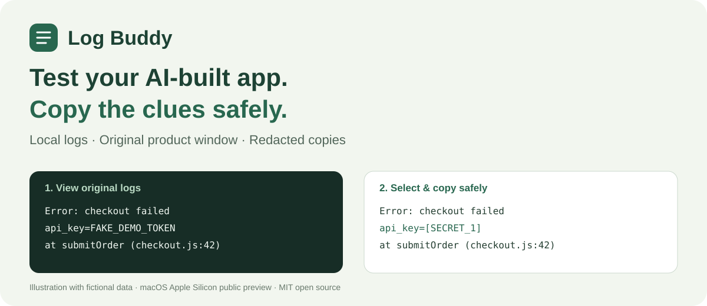
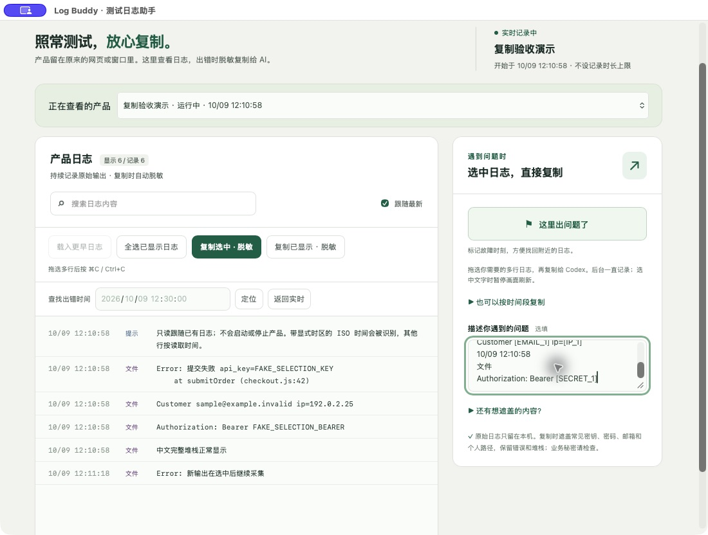

<p align="center"></p>

<p align="center"><b>Live product logs for people building with AI — select the problem, copy a redacted snippet, ask your agent to fix it.</b></p>

<p align="center"><a href="https://github.com/tracy586ymz-eng/log-buddy/releases/download/v0.4.2/Log-Buddy-mac-arm64-v0.4.2.zip"><b>Download Mac App</b></a> · <a href="https://github.com/tracy586ymz-eng/log-buddy/releases/tag/v0.4.2">Public preview &amp; release notes</a> · <a href="docs/README.zh-CN.md">中文说明</a> · <a href="https://github.com/tracy586ymz-eng/log-buddy/issues/new/choose">Report feedback</a></p>

<p align="center"><a href="LICENSE"></a>  </p>

## Your agent built the app. You found the bug. Now what?

You click the product link, test it in your normal browser or window, and something goes wrong. Finding terminal output, picking the right timestamp and removing secrets should not require opening an IDE.

**Log Buddy puts an independent log window beside the product.** Read the original logs, select the relevant lines, and copy a locally redacted snippet back to Codex or DeepSeek Harness. Errors and stack traces remain useful; the original record stays unchanged.

<p align="center"></p>
<p align="center"><sub>Actual Mac app. All values in this screenshot are fictional. The current desktop UI is Chinese.</sub></p>

## What it does

- **Keeps your normal testing flow.** Your website, browser preview, popup or native window stays where it normally opens.
- **Lets the agent prepare collection.** A one-time shared Skill tells the agent to collect its normal launch output or locate an existing product log.
- **Keeps full local history.** No one-minute recording limit or total-row eviction. Search older output, load earlier pages and locate a failure time; available disk space sets the real limit.
- **Redacts the copy, not the original.** Drag-select multiple lines and press **⌘C / Ctrl+C**, or use **复制选中 · 脱敏**. Common credentials, emails, IPs and personal paths are masked in the copied text.
- **Protects your selection.** Selecting text freezes the view while recording continues in the background.
- **Stays local.** No model API, telemetry or automatic sending of logs. You choose what to paste back to the agent.

## Download & get started

**Apple Silicon Mac · macOS 13.5+ · public preview**

1. [Download Log Buddy](https://github.com/tracy586ymz-eng/log-buddy/releases/download/v0.4.2/Log-Buddy-mac-arm64-v0.4.2.zip), unzip once, and move **Log Buddy.app** to Applications.
2. Open it and click **开启日志助手** once. The app installs its managed `customer-test-logs` Skill.
3. Start a new Codex / DeepSeek Harness conversation so it can discover the Skill. Ask your agent to start the product with test logs prepared, then test in the original product window.
4. When a bug appears, select the useful log lines and copy them. Paste the redacted result back to your agent.

**Before downloading:** this preview is ad-hoc signed and **not Apple-notarized**. macOS may prevent normal opening on another Mac; keep system protections in place. Node and Swift are bundled/not required for app users. English documentation is available; the desktop UI is currently Chinese. Windows and Intel Mac downloads are not provided yet.

The Skill is model guidance, not a guaranteed hook for every link click. If the product is already running and has saved logs, your agent can attach them read-only. Output that was never saved cannot be recovered; an authorized restart is needed to collect it. Fresh model-selected handoffs in each harness still need wider real-world testing.

A useful first request to your coding agent:

> Before you give me the product preview link, use customer-test-logs to prepare Log Buddy beside the product. Keep the original product window and launch command. If it is already running, reuse a confirmed existing log source; ask before restarting it. Do not ask me to find log paths.

## Connect your own AI

Log Buddy needs **no LLM key or model subscription**. Sign in or configure your own provider inside Codex / DeepSeek Harness, then enable the log Skill. [Step-by-step account and model setup](docs/llm-setup.md) · [中文接入指南](docs/llm-setup.zh-CN.md). Never send your key to Log Buddy or publish authentication files.

## How collection works

The agent runs the original command through a collector in its normal terminal. The product does not run inside Log Buddy.

```sh
# Agent/CLI use: preserve the original project, command and environment.
"/Applications/Log Buddy.app/Contents/MacOS/test-log-buddy" collect \
  --cwd /path/to/product --name "My product" -- npm run dev

# Or follow a confirmed existing product log without changing it.
"/Applications/Log Buddy.app/Contents/MacOS/test-log-buddy" watch \
  --file /path/to/product/runtime.log --name "My product"
```

Both prepare the independent viewer. Existing captures can be reopened with `sources` and `show --id <confirmed-id>`. See the [integration guide](docs/integration.md) for exact boundaries.

## Privacy and limits

Original records stay in your private local app-data directory. On Mac: `~/Library/Application Support/Log Buddy/records`. They are not sent to a server or added to this project. The viewer uses loopback-only, token-protected APIs. [Read the privacy notes](docs/privacy.md).

Redaction is assistance, not a guarantee that every business secret or partial credential will be detected. Review copied text, and add business identifiers under **还有想遮盖的内容？** when needed. Browser-only console errors, interactive TTY apps and remote logs need other adapters. File timestamps without an explicit timezone use read time. Individual oversized lines are omitted with a notice; the history is otherwise not capped by duration or row count.

## Development & trust

MIT open source, with a small native Mac shell and a local Node service. The packaged app includes its runtime; no cloud account is required for Log Buddy itself.

```sh
# Node >=22.13; Node 24 is used for the Mac bundle.
npm ci
npm test
npm run build  # native Mac build also needs Swift
```

Twenty core/integration checks cover long history, stack boundaries, copy redaction, read-only file following, source isolation and process survival. Native Mac selection, keyboard/button copying and packaged SQLite operation were checked locally. Public CI verifies the core suite separately.

[Contributing](CONTRIBUTING.md) · [Changelog](CHANGELOG.md) · [Integration details](docs/integration.md)

## Help shape the next release

Useful feedback is a short description of your harness, OS and the step where the flow broke — **with redacted snippets only**. We are prioritizing reliable handoffs, grouping multiple services for one product, English UI and easier signed distribution.

If Log Buddy saves you a trip to the terminal, **star this project to help others find it**. Stars do not replace bug reports or guarantee any outcome; practical feedback is what improves the app.
